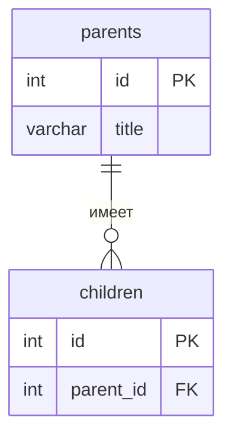

<!--
  Это шаблон README проекта. После создания своего репозитория:
  1. Переименовать репозиторий в backend-<фамилия>-<тема>, например backend-ivanova-library.
  2. Заполнить разделы ниже под свою тему и удалить этот комментарий.
  Задания лаб лежат в папке docs/, начинать с docs/README.md.
-->

# Название проекта

Тема №2: **Кинотеатр**. Сервис для просмотра расписания сеансов и покупки билетов.

| | |
| --- | --- |
| Главная сущность | Сеанс (`/api/sessions`) |
| Связанная сущность (1:N) | Билет (`/api/sessions/{id}/tickets`) |
| Фишка | Одно место на сеанс нельзя продать дважды (409) |
| Стек | Python, Django, Django REST Framewor|

## Как запустить

```bash
git clone <https://github.com/ntquan1205/Backend-.git>
cd <ПАПКА_ПРОЕКТА>

Создать и активировать виртуальное окружение:
python -m venv venv
venv\Scripts\activate (Для Window)
source venv/bin/activate (Для Macbook)

Установить зависимости
pip install -r requirements.txt

Запустить сервис
python manage.py runserver 8000
Сервис работает на `http://localhost:8000`. Запросы для демонстрации лежат в `requests.http`.

## Эндпоинты

| Метод | Путь | Что делает | Ответ |
| --- | --- | --- | --- |
| GET | `/health` | Проверка, что сервис жив | 200 `{"status":"ok"}` |
| POST | `/api/sessions` | Создать | 201 и объект с `id`; 400 при ошибке |
| GET | `/api/sessions` | Список | 200 |
| GET | `/api/sessions/{id}` | Получить одну запись | 200; 404 |
| PATCH | `/api/sessions/{id}` | Изменить | 200; 400; 404 |
| DELETE | `/api/sessions/{id}` | Удалить | 204; 404 |

## ER-диаграмма

<!-- С лабы 2. Блок mermaid GitHub рисует сам. -->



## Интерфейс

<!-- С лабы 4: скриншот, например  -->
